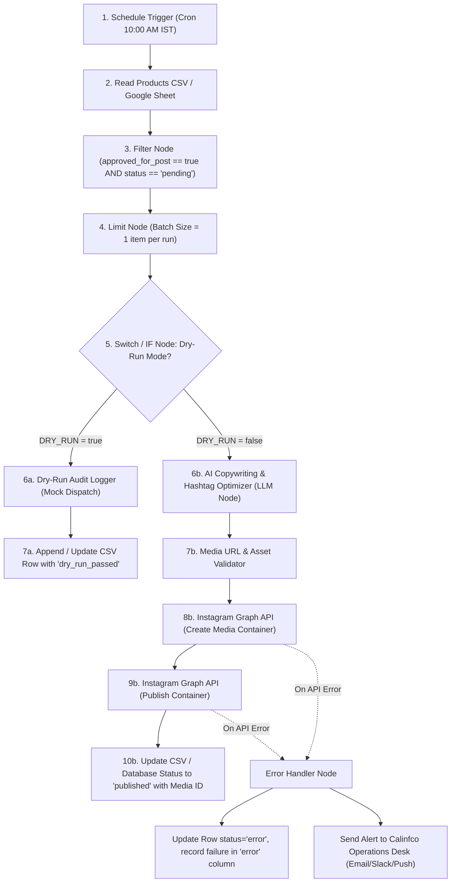

# Calinfco n8n Automation Architecture & Workflow Plan

This document details the planned automation pipeline for social media publishing, order notifications, and preventive maintenance reminders in the Calinfco Water Purifiers ecosystem.

---

## 1. Objective & Scope

The n8n automation engine operates locally within Docker to orchestrate multi-step asynchronous business logic without exposing credentials or hardcoding API logic inside mobile or web frontends.

### Planned Daily Automation: Social Media Product Spotlight
- **Goal:** Automatically select an approved product from `Products-template.csv`, format marketing copy with hashtags, prepare image assets, and publish to social channels (e.g., Instagram Graph API) with dry-run safety and error audit logging.
- **Schedule:** Runs daily at 10:00 AM IST (`TZ=Asia/Kolkata`).

---

## 2. Planned Daily Workflow Node Architecture



---

## 3. Detailed Node-by-Node Execution Order

| Step # | Node Name | Type | Purpose | Inputs / Conditions |
|---|---|---|---|---|
| **1** | **Daily Schedule Trigger** | `n8n-nodes-base.cron` | Fires every day at 10:00 AM IST | `0 10 * * *` (Timezone: `Asia/Kolkata`) |
| **2** | **Read Products Data** | `n8n-nodes-base.spreadsheetFile` / `googleSheets` | Ingests catalog data containing copy & prompts | Reads `Products-template.csv` |
| **3** | **Approved Post Filter** | `n8n-nodes-base.filter` | Selects only verified catalog items awaiting publication | `approved_for_post == true` AND `status == 'pending'` |
| **4** | **Item Limiter** | `n8n-nodes-base.limit` | Prevents spamming; publishes exactly one item per execution | Max items: `1` |
| **5** | **Dry-Run Mode Check** | `n8n-nodes-base.if` | Inspects environment variable `DRY_RUN` | If `{{ $env.DRY_RUN === 'true' }}` route to dry-run |
| **6a** | **Dry-Run Audit Logger** | `n8n-nodes-base.code` | Logs formatted payload without external network calls | Simulates publishing, checks field lengths |
| **6b** | **AI Copywriting Polish** | `n8n-nodes-base.openAi` / `code` | Enhances caption based on verified purifier specs | Input: `verified_description`, `category` |
| **7b** | **Media Asset Validator** | `n8n-nodes-base.httpRequest` | Sends `HEAD` request to verify image availability | HTTP 200 required on `image_url` |
| **8b** | **Instagram Container Creator** | `n8n-nodes-base.httpRequest` | Submits media URL & caption to Meta Graph API | `POST /v19.0/{ig_user_id}/media` |
| **9b** | **Instagram Media Publisher** | `n8n-nodes-base.httpRequest` | Finalizes media container publication | `POST /v19.0/{ig_user_id}/media_publish` |
| **10b** | **Update Catalog Row** | `n8n-nodes-base.code` / file update | Records `instagram_media_id`, timestamp, and status | `status='published'`, `published_at=now` |

---

## 4. Error Handling & Circuit Breakers

1. **Continue on Fail:**
   - Network nodes have **Continue on Fail** enabled so unexpected timeouts do not crash the n8n execution engine.
2. **Dedicated Error Trigger Node:**
   - A global `Error Trigger` node catches uncaught exceptions in the workflow.
3. **Audit Trail Updating:**
   - When a publishing call fails (e.g., token expired, image resolution invalid), the error message is extracted and saved directly into the `error` column of `Products-template.csv`.
   - The product's `status` changes from `pending` to `error`, preventing repeated failed loops on subsequent daily runs.
4. **Operations Alert:**
   - An alert payload is routed to the Calinfco Admin Service Desk endpoint (`/api/notifications/sms` or email) alerting the marketing administrator.

---

## 5. Dry-Run Mode

- When `DRY_RUN=true` (the default setting in local development):
  - No external API requests are made to Instagram, Meta, or external social networks.
  - Image URLs and caption formatting are validated locally.
  - Execution logs display:
    ```json
    {
      "mode": "DRY_RUN",
      "action": "mock_instagram_publish",
      "product_id": "CP-RO-001",
      "caption_preview": "Pure health in every drop 💧 Upgrade to Calinfco...",
      "image_url_verified": true,
      "status": "dry_run_passed"
    }
    ```
  - This allows developers to test scheduling, parsing, and data flow safely without publishing test data to live company accounts.

---

## 6. Integration Dependencies

| Service / Dependency | Environment Variable | Purpose | Status in Dev |
|---|---|---|---|
| **n8n Core** | `N8N_ENCRYPTION_KEY` | Encrypts workflow credentials in local database | **Configured locally** via `.env` |
| **Timezone** | `TZ=Asia/Kolkata` | Guarantees executions align with IST business hours | **Configured** in `compose.yaml` |
| **Catalog Data** | `Products-template.csv` | Master product information and social copy | **Included** in `automation/n8n/` |
| **Meta Instagram Graph API** | `META_INSTAGRAM_ACCESS_TOKEN` | Publishing images and captions to business page | **Unconfigured** (Simulated via Dry-Run) |
| **OpenAI / LLM API** | `OPENAI_API_KEY` | Dynamic caption enrichment and hashtag suggestions | **Unconfigured** (Template fallback used) |

---

## 7. Zero-Deception & Live Implementation Rules

- **Zero-Deception Rule:** Live publishing is **NOT** enabled until valid Meta Business Developer credentials and approved Instagram accounts are configured in `.env`.
- **Zero-Leaks Policy:** Tokens and client secrets must **NEVER** be committed to version control or hardcoded in JSON workflows.
